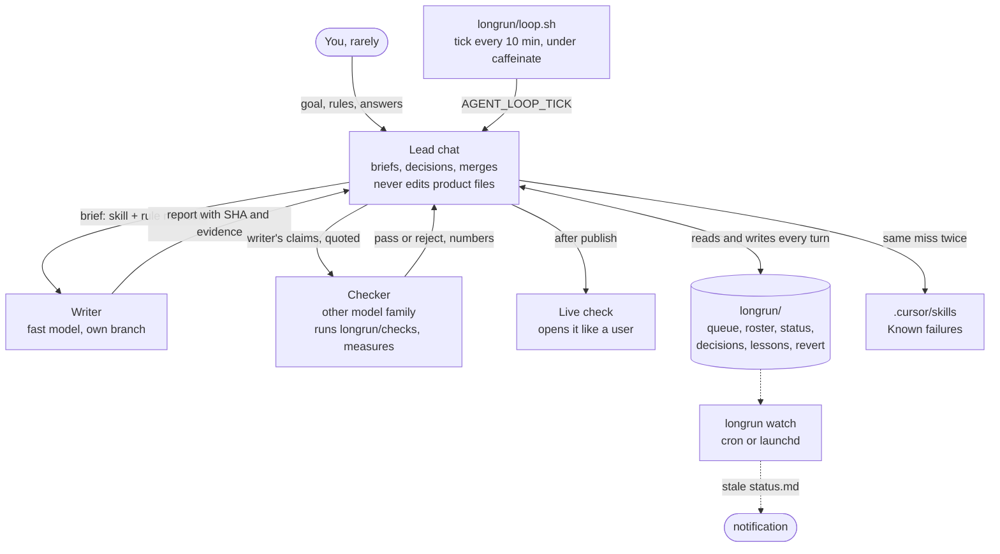

# long-horizon-harness

A kit for running one task for many hours in Cursor without you: one long-lived lead chat, short-lived worker subagents, checkers on a different model, and all shared state in small plain files. It comes from two measured runs (41.8 h and 170 h) and the article that analyses them: [How to run autonomous long-horizon tasks in Cursor](<article-url>). The `longrun` CLI installs the kit into your repo, checks it is ready before you leave, shows the board while it runs, alerts you when it stalls, and measures the run afterwards from Cursor's local database.

## Quick start (60 seconds)

Inside your project's git repo:

```bash
curl -fsSL https://raw.githubusercontent.com/Himanshu-Sangshetti/long-horizon-harness/main/install.sh | bash -s -- --preset code --goal "Every public function has a tested example"
```

(The curl line works once this repo is public. Until then: clone it and run `/path/to/long-horizon-harness/install.sh --preset code` from your project.)

1. **Fill the blanks.** `grep -rn '<<FILL' longrun .cursor` shows them: the units in `longrun/queue.md`, `longrun/revert.md`, the model names in `.cursor/rules/longrun-models.mdc`, and your test command in `longrun/config.env`. Commit.
2. **Run `longrun doctor`** until it says `ready`. Every failure prints a fix line.
3. **Start the lead.** In Cursor, open a new Agent chat and type `/longrun-start` (or paste `longrun/prompts/start-lead.md`). Grant the permissions it asks for. Then leave, and check in with `longrun status`.

## How it works



What wakes the lead: a worker finishing, a timer tick, or you. Workers are one level deep and never talk to each other; the lead passes evidence between them (writer claims go into the checker brief, checker findings go into the fix brief). The lead writes `longrun/status.md` every turn, so you read a file instead of interrupting it.

## Pick a preset

Two properties decide how long a run can go alone: can the work be split into independent units, and can something other than you check each unit?

| Preset | Pick it when | Units | Gate | Adds |
| --- | --- | --- | --- | --- |
| `code` | units are independent changes and your tests can judge them | one branch and worktree per unit (`longrun unit new`) | `checks/tests.sh` runs `LONGRUN_TEST_CMD` and `LONGRUN_LINT_CMD` | `longrun-code` skill |
| `content` | units are pages, docs, lessons or question sets that get published | writer, then checker, then live-check | numeric content gates + `checks/live.sh` (Playwright, desktop and 390 px) | `longrun-content` skill, Playwright path in config so workers do not hunt for it |
| `shared` | everything lives in one codebase that must keep building (a game, an app without per-unit branches) | file ownership per workstream in `longrun/owners.md` | `checks/build.sh` prints `BUILD OK` / `BUILD FAILED` under a build-slot lock | `longrun-shared` skill, collision rule, `scripts/lock.sh` |

If you can, shape the work so `code` or `content` fits. With a branch per unit, the content run had 2 merge conflicts across 308 workers. On one shared tree, the game run's first wave of eight parallel workers hit 15 failed compiles, almost all inside another worker's half-written file.

## Files

After `longrun init`, your repo has:

| Path | What | Written by |
| --- | --- | --- |
| `.cursor/rules/longrun-models.mdc` | role to model map (always applied) | you |
| `.cursor/skills/longrun-{lead,writer,checker,live-check}/SKILL.md` | one job description per role | you; the lead adds Known failures |
| `.cursor/skills/longrun-<preset>/SKILL.md` | preset rules | you; the lead |
| `.cursor/commands/longrun-start.md`, `longrun-status.md` | `/longrun-start` and `/longrun-status` | you |
| `longrun/config.env` | preset, tick, stale minutes, test/build commands, lead chat id | you |
| `longrun/queue.md` | goal, done-when, the order of work, questions for you | you, lead |
| `longrun/preferences.md` | your numbered standing rules | you, lead on your word |
| `longrun/status.md` | one-screen status, rewritten every turn | lead |
| `longrun/roster.tsv` | who is doing what (`id seat skill model state now next`) | lead, `longrun unit` |
| `longrun/decisions.tsv` | every pass and reject with its SHA | checkers |
| `longrun/lessons.tsv` | one row per merge or reject; `twice=yes` means patch a skill | lead |
| `longrun/revert.md` | pre-run SHA, what landed, how to undo it | you, lead |
| `longrun/handoff.md` | what a restarted lead needs | lead |
| `longrun/prompts/` | start, restart, writer, checker and fix briefs | you; lead fills them |
| `longrun/loop.sh` | the timer | you |
| `longrun/checks/` | check scripts (contract below) | you, checkers |

This repo: `bin/longrun` (the CLI), `install.sh`, `kit/` (base files), `presets/` (layered on top), `tools/trace_report.py` (measurement), `tests/smoke.sh`, `examples/hello-queue/` (state files mid-run), `examples/watch/` (launchd job).

### Check script contract

Every script in `longrun/checks/` prints evidence lines (what it measured, with the number), ends with `PASS <name>` or `FAIL <name>: <reason>`, and exits 0 on pass, 1 on fail, 2 on a setup error. Checkers treat a green script as the floor, not the pass: they quote measured numbers and look for what the script cannot see. The checker skill also shows how to turn taste into numbers ("feels wobbly" became "at most 2 yaw-rate sign changes per 10 s" plus frame sequences every 0.25 s).

## What the runs taught us

Two runs, same person, same harness: a content run (41.8 h, 308 workers) and a game run (final 54 h analysed). Not a controlled experiment; see the article for method and caveats.

| # | Lesson | The number behind it | In the kit |
| --- | --- | --- | --- |
| 1 | Measure unattended time, not tool-call share. | Both runs were 99% "autonomous" by tool share, but one ran 16.0 h without a human and the other 1.3 h. [more](<article-url>#c1) | `longrun report` prints H and why it ended |
| 2 | Write the order of work into a file before you leave. | 29 of 79 game-run interruptions were the agents asking for the next task. [more](<article-url>#c2) | `queue.md`; doctor fails on an empty queue |
| 3 | Have the lead write status to a file. | 9 of 79 interruptions were "what is going on?". [more](<article-url>#c2) | lead writes `status.md` every turn; `longrun status` |
| 4 | Turn taste into numbers before the run. | Work a script or checker could judge was accepted 23 of 24 times; look-and-feel work 4 of 12. A numeric flight brief cut wobble from 4.17 to 0.48 direction changes per 10 s. [more](<article-url>#c5) | checker skill section and example |
| 5 | Keep the lead out of the product. | Coordination share rho was 0.77 in the run that went 16 h alone, 0.13 in the run that needed a human every 41 min. [more](<article-url>#c3) | lead rule; product touches in `status.md`; `report` prints rho |
| 6 | Keep the lead's chat short; restart it. | The game lead re-read 130.5M tokens, more than all its workers combined (95.8M). A restart every 100 turns from a 15K handoff gives 29.6M (simulated). [more](<article-url>#c8) | `handoff.md`, `restart-lead.md`, `LONGRUN_RESTART_TURNS` |
| 7 | Add checkers freely, on a different model family. | Checkers made 33.5% of worker tool calls but used 13% of worker tokens. [more](<article-url>#c4) | model map; brief templates |
| 8 | Require evidence in every report. | Reports with URLs or PR numbers were verified 59% of the time, against 19% without. [more](<article-url>#c5) | writer report format; lead sends back reports without it |
| 9 | Self-improving skills close shortcuts but do not lower the reject rate on their own. | Reject share went from 32% to 22%, 95% CI -28 to +8 points. 11 skill lines closed shortcuts like padding files to a line count. [more](<article-url>#c6) | Known failures sections; `lessons.tsv` |
| 10 | Keep the machine awake and watch from outside it. | Four gaps (542 min, 22% of the content run) where nothing ran; 3 of 4 worker errors arrived as a gap ended. The lead spent 112 calls checking its own loop. [more](<article-url>#c7) | `loop.sh` under `caffeinate`; `longrun watch` |

## Measure your run

Find your lead chat, then report on it:

```bash
longrun report --list-chats            # recent top-level chats: created, workers, id, title
longrun report --chat <composerId> --since 2026-09-21T06:45:00+05:30 --until 2026-09-23T00:31:00+05:30
```

Set `LONGRUN_LEAD_CHAT` in `longrun/config.env` to drop `--chat`. Real output for the content run from the article (state folder name redacted):

```
lead chat   16cf6fa9-9dbb-4463-8611-b562fd41f154
window      2026-09-21 06:45 to 2026-09-23 00:31  (41.8 h)

H  unattended horizon   16.0 h  (2026-09-22 08:19 to 2026-09-23 00:21), ended by a human message

autonomy, five ways
  A_tool     99.9%   tool calls / (tool calls + human messages)   [44957 calls, 45 human]
  A_wake     92.9%   lead wakes not caused by a human            [633 wakes]
  A_call30   68.5%   tool calls >30 min after the last human message
  A_busy     80.1%   busy minutes >30 min after the last human message
  A_active   66.3%   busy minutes / wall-clock minutes            [1661 of 2506]

wake sources  subagent_done 393, timer_tick 178, human 45, other_notification 17

lead mix (6922 calls, state dir '<state-dir>')
  coordination      4307   62.2%
  implementation     899   13.0%
  spawn              443    6.4%
  other             1273   18.4%
  rho = coordination / (coordination + implementation) = 0.83

workers     321 found, 313 active in the window, 38035 tool calls
worker life median 5.4 min, p90 25.4, max 583.8
```

H and the five autonomy measures match the article. rho here comes from a simpler path-based classifier than the article's: it gives 0.83 for this run and 0.14 for the game run (article: 0.77 and 0.13). Use it to watch the trend within a run, not as an exact number.

How it reads the data: it opens `state.vscdb` read-only (macOS `~/Library/Application Support/Cursor/User/globalStorage/`, Linux `~/.config/Cursor/User/globalStorage/`, Windows `%APPDATA%\Cursor\User\globalStorage\`), reads only `composerData:*` and `bubbleId:*` keys, and never reads settings or auth keys. Human messages are not printed unless you pass `--show-human`, and long tokens are redacted. If Cursor has the file locked, copy it first: `sqlite3 -readonly <db> ".backup /tmp/copy.vscdb"` and pass `--db /tmp/copy.vscdb`. Cursor stores no billed token counts, so the tool reports no cost.

## Watch from outside the chat

`longrun watch` exits 1 and posts a notification when no state file has changed for `--stale-min` minutes (default `LONGRUN_STALE_MIN`, 30). Since the lead rewrites `status.md` every turn, a stale file means the lead stopped. Run it on a schedule:

```bash
# cron: every 10 minutes
*/10 * * * * /ABSOLUTE/PATH/TO/longrun -C /ABSOLUTE/PATH/TO/your-repo watch --stale-min 30 >> /tmp/longrun-watch.log 2>&1
```

On macOS use the launchd job in [`examples/watch/dev.longrun.watch.plist`](examples/watch/dev.longrun.watch.plist). A watcher on the same Mac catches a stuck lead or a dead loop, but it sleeps with the Mac, so it only tells you about a sleep after the Mac wakes. To catch that while it happens, run `longrun -C <repo> watch` from another machine over ssh.

## Is this a harness?

Not really. In Cursor, the harness (the agent loop, tools, context handling, subagents, the Task tool) is Cursor's agent. This repo is an orchestration kit on top of it: the roles, the files they share, the rules, the checks, and a CLI that sets them up and measures the result.

What is Cursor-specific:

- `.cursor/rules/*.mdc` (always-applied model map), `.cursor/skills/*/SKILL.md`, `.cursor/commands/*.md`.
- Spawning workers with the Task tool and a per-worker `model`.
- The timer: a background shell watched with `notify_on_output`, from Cursor's built-in loop skill (`/loop`). This is how the runs worked; it is not a documented public API, so it may change.
- `tools/trace_report.py`, which reads Cursor's local database layout.

What is portable: everything under `longrun/` (state files, briefs, checks, loop), the skills' text, and `longrun init/doctor/status/unit/watch`. To port to another agent CLI that has subagents: put the skills where that tool loads instructions (for example an `AGENTS.md` or its skills folder), replace "Task tool with model" in the lead skill with that tool's subagent call, and wake the lead with that tool's scheduler or a cron job that sends the tick prompt. `longrun report` will not work there; the measures (H and the five A's) are defined in the article so you can compute them from that tool's logs.

## What we could not verify

- **Slash commands.** Cursor's current docs describe skills and say `/migrate-to-skills` converts "slash commands" into skills with `disable-model-invocation: true`. They do not document `.cursor/commands/*.md` itself. The kit ships `/longrun-start` and `/longrun-status` there because Cursor has read commands from that folder, but we have not confirmed it in the current version. If they do not appear in your `/` menu, run `/migrate-to-skills` or paste `longrun/prompts/start-lead.md`.
- **Cache lifetime.** The article found a 1-hour prompt cache about 13x cheaper per wake than a 5-minute one. As far as we know Cursor does not let you choose; the lead skill says to prefer it where possible.
- **Nesting.** Cursor 2.5+ lets a subagent start one more level of subagents. The kit keeps workers at depth one on purpose; nothing enforces it except the skills.
- **Linux and Windows.** The smoke test passes locally on macOS; the CI workflow runs it on macOS and Ubuntu but has not run yet. Windows is untested (use WSL).

## Limitations

- Two runs are evidence, not proof. The kit encodes what the traces suggest, and several findings are observational.
- The kit does not make taste checkable for you. If only you can judge a unit, the run will wait for you; write numbers first.
- Self-improving skills grow while you correct the run and mostly stop when you leave. Plan for 20 to 30% of units to be rejected.
- `longrun watch` sees file changes, not progress. A lead that rewrites `status.md` while stuck looks alive; read the board.
- Spend: Cursor does not expose per-run cost. Decide a limit before you leave and check your usage dashboard.

## FAQ

**Can I use it in an existing repo with its own `.cursor/` folder?** Yes. Kit files are prefixed `longrun-`; `init` refuses to overwrite anything unless you pass `--force`.

**Where do worktrees go?** `../<repo>-<unit>` by default. Change `LONGRUN_WORKTREE_DIR` or pass `--dir`. `longrun unit done` refuses to remove an unmerged branch unless you pass `--force`.

**How many workers at once?** Little's law: average workers alive = start rate x average life. The content run started about 7.4 an hour with a 20-minute mean life, so about 2.5 on average (peak 14). Start with two or three; on the `shared` preset, grow only while builds stay green.

**Do I have to use `caffeinate`?** `loop.sh` uses it on macOS automatically. Without it, the timer stops when the Mac sleeps, and so does the run.

**Why plain files and not a database?** Every agent can read and write them with the tools it already has, you can read them in a diff, and they go into git with the work.

**How do I see the state files mid-run?** `examples/hello-queue/` is a small filled example, three doc units about 50 minutes in.

## Development

```bash
bash tests/smoke.sh                       # init for every preset, doctor, status, unit, watch, checks
python3 -m py_compile tools/trace_report.py
shellcheck bin/longrun install.sh kit/longrun/*.sh kit/longrun/checks/*.sh presets/*/longrun/*/*.sh
```

## License

MIT. See [`LICENSE`](LICENSE).
