# cursor-longrun

Run one task in Cursor for many hours without you.

This is the setup from my article **[Cursor for Autonomous Long Horizon Tasks](https://x.com/himanshutwtxs/status/2110027536088596486)**, packaged so you can drop it into your own repo. It ran two long tasks:

- **A content factory** for CloudFluently: 42 hours (16 of them straight with no human input), 44,865 tool calls, 308 subagents, ~1.8k commits.
- **A game build** ([Moonlit Grid](https://hxlfed.itch.io/moonlit-grid)): about 170 hours, 24.8k tool calls, 682 commits, ~4.3k screenshot checks. Not fully autonomous.

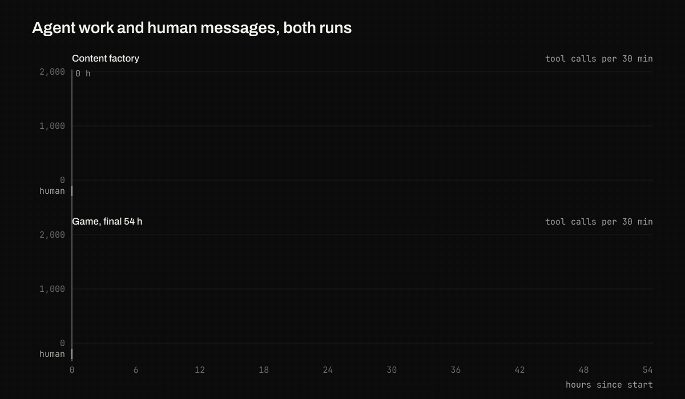

It is not a harness. Cursor's agent is the harness. This repo is what goes on top of it: the roles, the shared state files, the rules, the checks, and a small CLI (`longrun`) that sets them up, tells you when the run is ready to leave alone, and measures it afterwards.

## The setup

- **Lead:** one Cursor chat that plans, writes briefs, starts workers and merges. It never edits product files.
- **Workers:** short-lived subagents, one job each, on a fast model. They never start other workers.
- **Checkers:** separate workers on a different model family whose only job is pass or reject, with numbers.
- **State files:** small plain files in `longrun/` (queue, roster, status, decisions, lessons, revert) that every agent reads and writes.
- **Skills:** one per role. When the same failure happens twice, the lead adds a line to the skill.
- **Loop:** a 10-minute timer under `caffeinate`, so the lead keeps waking up while you're away.

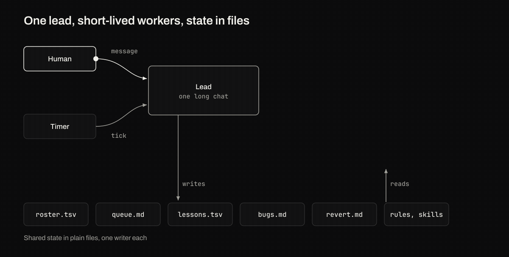

## Quick start

Inside your project's git repo:

```bash
curl -fsSL https://raw.githubusercontent.com/Himanshu-Sangshetti/cursor-longrun/main/install.sh | bash -s -- --preset code --goal "Every public function has a tested example"
```

1. **Fill the blanks.** `grep -rn '<<FILL' longrun .cursor` lists them: the order of work in `longrun/queue.md`, your rollback notes in `longrun/revert.md`, model names in `.cursor/rules/longrun-models.mdc`, and your test command in `longrun/config.env`.
2. **Run `longrun doctor`** until it says `ready`. Every failure prints its fix.
3. **Start the lead.** Open a new Agent chat in Cursor and type `/longrun-start` (or paste `longrun/prompts/start-lead.md`). Grant the permissions it asks for, then leave. Check in with `longrun status`.

## Pick a preset

Whether a run can go long without you depends on two questions: can the work be split into independent units, and can something other than you check each one?

| Preset | Use it when | Each unit is checked by |
| --- | --- | --- |
| `code` | units are independent changes your tests can judge | your test and lint commands, on its own branch |
| `content` | units are pages, docs or lessons that get published | numeric content checks, then a live check of the published page |
| `shared` | everything is one codebase that must keep building (a game, an app) | a build check under a build-slot lock, with file ownership per workstream |

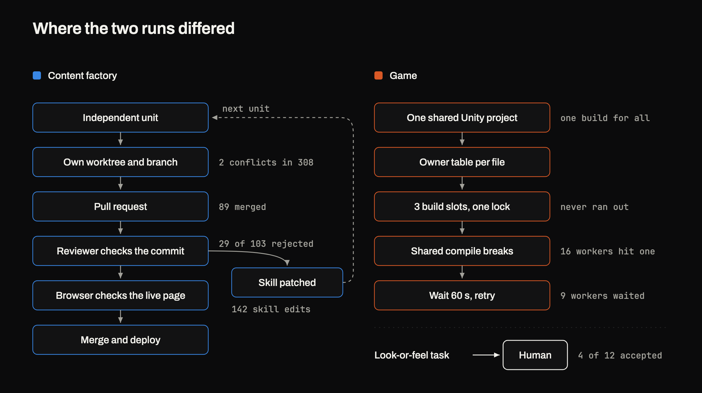

Prefer `code` or `content` if you can shape the work that way. With a branch per unit, the content run had 2 merge conflicts across 308 workers. On one shared tree, the game run's first eight parallel workers hit 15 failed compiles.

## What the traces showed

Everything below comes from Cursor's local database for the two runs. It's two runs, not a controlled experiment. The [article](https://x.com/himanshutwtxs/status/2110027536088596486) has the full analysis, the math and the caveats.

### "99% autonomous" doesn't mean much

Both runs were 99% autonomous by tool-call share, yet one ran 16 hours without a human and the other 1.3. One message can set off hundreds of tool calls, so measure unattended time instead.

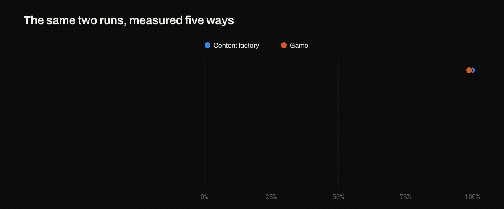

**In the kit:** `longrun report` prints the longest unattended stretch and what ended it.

### The harness almost never stopped the run

Of 79 human messages in the game run's last 54 hours, only 3 were the harness breaking. The biggest group was agents running out of written-down work.

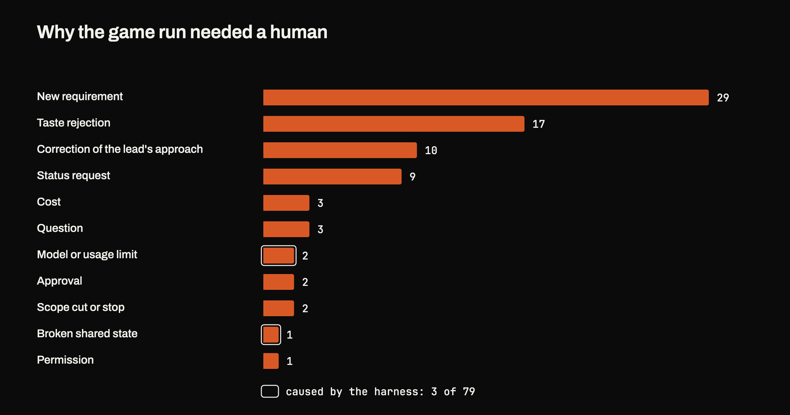

**In the kit:** `queue.md` holds the order of work, and `doctor` fails if it's empty. The lead rewrites `status.md` every turn, so you read a file instead of asking.

### Checkable work gets accepted, taste doesn't

Work a script could judge was accepted 23 of 24 times. Work judged on look or feel, 4 of 12. Turn "looks right" into numbers before the run.

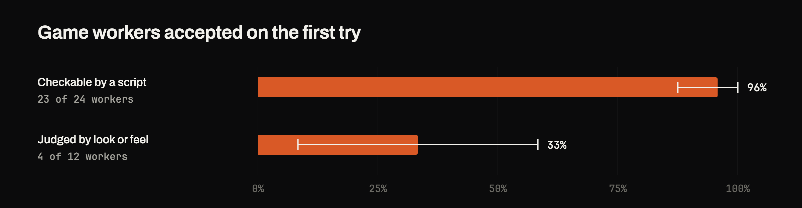

**In the kit:** the checker skill and `longrun/checks/`, plus an example of turning taste into numbers.

### Keep the lead out of the product

The content lead only coordinated and ran 16 hours alone. The game lead wrote code itself, workers waited, and decisions fell back to a human every 41 minutes.

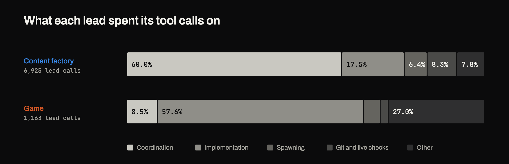

**In the kit:** the lead skill's first rule is that it never edits product files, and `longrun report` prints the coordination share.

### The lead's chat is the expensive part

Every turn re-reads the whole chat, so cost grows quadratically. The game lead re-read 130.5M tokens, more than all its workers combined. Restarting it every 100 turns from a handoff file would cut that by 77% (simulated).

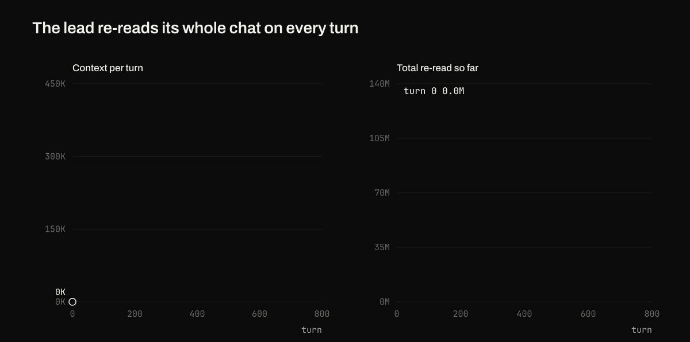

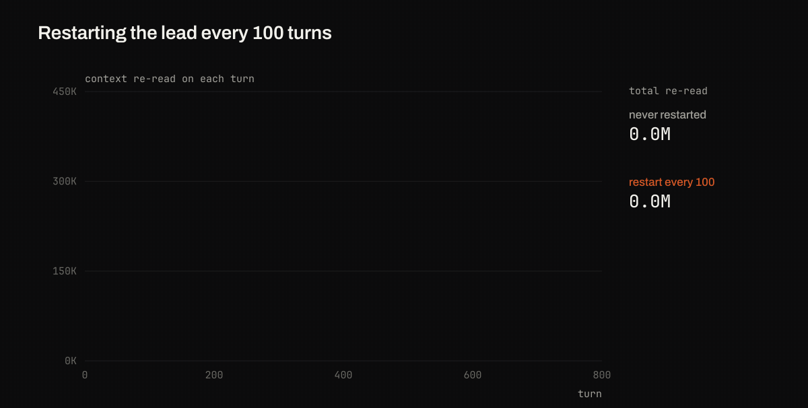

**In the kit:** `handoff.md` and a restart prompt.

### Skills learn from failures

When a checker rejects a unit twice for the same reason, the lead adds a line to the skill. Some lines close shortcuts workers found, like padding files to hit a line count. This doesn't lower the reject rate on its own, so plan for 20 to 30% of units being rejected.

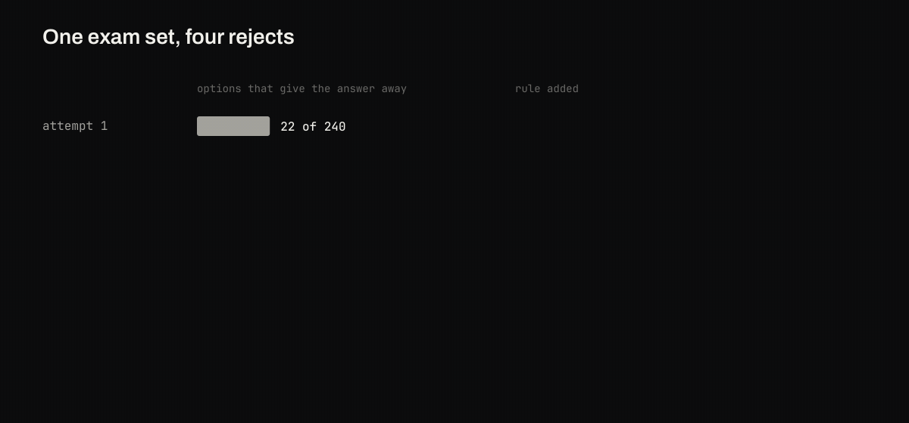

**In the kit:** `lessons.tsv` and a "Known failures" section in every skill.

### Cache and sleep

The expensive wake-up was a worker finishing just after the 5-minute prompt cache expired. And the content run lost over 9 hours to a sleeping laptop.

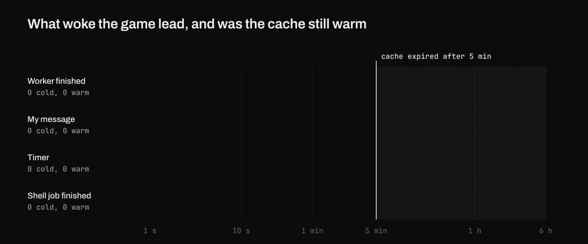

**In the kit:** `loop.sh` runs under `caffeinate`, and `longrun watch` alerts you from outside the chat when the run goes quiet.

## Measure your run

```bash
longrun report --list-chats              # find your lead chat
longrun report --chat <id>               # unattended hours, five autonomy measures, wake sources, worker stats
```

It reads Cursor's local database read-only and never touches settings or auth keys.

## More

- [`docs/reference.md`](docs/reference.md): every file the kit installs, the check-script contract, watching a run from outside, what is Cursor-specific vs portable, what we couldn't verify, FAQ.
- [`examples/hello-queue/`](examples/hello-queue/): what the state files look like mid-run.
- Works on macOS and Linux (CI runs both). Windows via WSL, untested.

MIT licensed.
